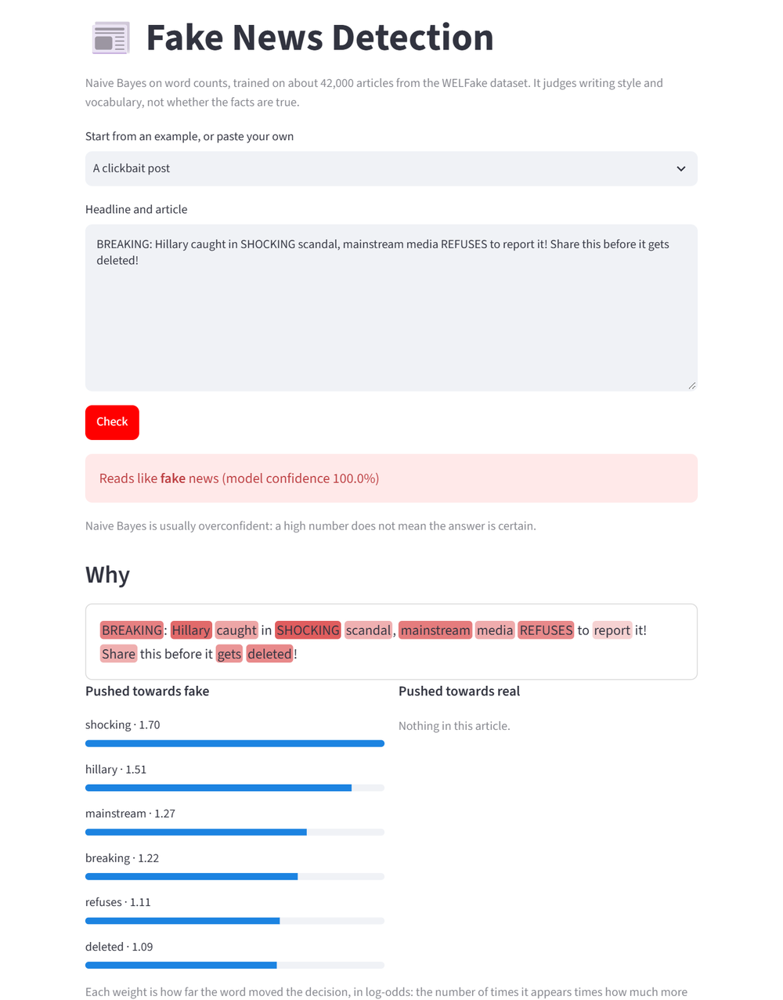

<h1 align="center">Fake News Detection</h1>

<p align="center"><strong>Says whether a news article reads like real or fake news, from its words alone.</strong></p>

<p align="center">
  <a href="https://github.com/Cl0ud-9/Fake-News-Detection/actions/workflows/ci.yml"></a>
  <a href="LICENSE"></a>
  
  
</p>

<p align="center">
  <a href="#quick-start">Quick start</a> &nbsp;·&nbsp;
  <a href="#results">Results</a> &nbsp;·&nbsp;
  <a href="#the-data">The data</a> &nbsp;·&nbsp;
  <a href="#retrain">Retrain</a> &nbsp;·&nbsp;
  <a href="#honest-limits">Honest limits</a>
</p>

<br>

<p align="center">
  
</p>

Paste a headline and article, and the app says whether it reads like the real or the fake news it was trained on. It
counts the words in the article and asks a Naive Bayes classifier, trained on about 42,000 labelled articles from the
WELFake dataset, which kind of article uses those words more. A random forest on the same counts is more accurate and
can be downloaded or trained with one command.

## Quick start

You need Python 3.11, 3.12, 3.13 or 3.14. The trained model is in the repository, so nothing else needs downloading.

```bash
git clone https://github.com/Cl0ud-9/Fake-News-Detection.git
cd Fake-News-Detection
python -m venv .venv
.venv\Scripts\activate          # macOS/Linux: source .venv/bin/activate
pip install -r requirements.txt
streamlit run app.py
```

Or from the command line:

```bash
python predict.py "WASHINGTON (Reuters) - The Senate passed the budget bill on Tuesday, officials said."
# real (model confidence 100.0%)
python predict.py --file article.txt
```

## Results

Measured by `train.py` on 20,655 articles held out from training: a third of WELFake after duplicates are removed,
split at random with the same mix of real and fake on both sides.

| Model | Accuracy | Real: precision / recall | Fake: precision / recall | Model size | Trains in |
|---|---|---|---|---|---|
| Naive Bayes (in the repository) | **89.1%** | 0.891 / 0.915 | 0.890 / 0.859 | 2.8 MB | under 20 s |
| Random forest, 300 trees ([release download](https://github.com/Cl0ud-9/Fake-News-Detection/releases/latest)) | **92.0%** | 0.905 / 0.956 | 0.941 / 0.874 | 85 MB | about 90 s |

Both read the same input: the headline and body together, as counts of each word, with common English words left out.
To use the random forest, download `fake_news_rf.joblib` from the latest release into `models/`, then
`python predict.py --model models/fake_news_rf.joblib "..."` or `FAKE_NEWS_MODEL=models/fake_news_rf.joblib streamlit run app.py`.

The [notebooks](notebooks) hold the original 2024 work, including an LSTM on a different dataset (the [Kaggle Fake News
competition](https://www.kaggle.com/c/fake-news)) that reached 89% on its test set.

## The data

[WELFake](https://www.kaggle.com/datasets/saurabhshahane/fake-news-classification) has 72,134 English news articles
from four earlier datasets, labelled real or fake. After dropping 1,341 articles without a title or body, and 8,203
duplicates, 62,590 remain.

> **About the labels.** WELFake's description says label 0 is fake and 1 is real, but the articles say the opposite:
> 21,266 of the 21,282 articles bylined "(Reuters)" are labelled 0, and all 1,272 articles from the conspiracy site
> 21st Century Wire are labelled 1. This project follows the data: **0 is real, 1 is fake**.

## Retrain

Download `WELFake_Dataset.csv` from Kaggle, then:

```bash
python train.py --data WELFake_Dataset.csv               # Naive Bayes -> models/fake_news_nb.joblib
python train.py --data WELFake_Dataset.csv --model rf    # random forest -> models/fake_news_rf.joblib
```

Each run prints the held-out accuracy, a per-class report and a confusion matrix, and saves them next to the model as
`.metrics.json`. A saved model only loads with the scikit-learn version that saved it, which `requirements.txt` pins.

## Honest limits

<details>
<summary>What the model judges, and what it cannot</summary>

<br>

- **It judges style, not truth.** The model has learned which words fake and real articles in WELFake tend to use. A
  false story written like a wire report will pass; a true one written in capitals with exclamation marks will not.
- **It knows one period of English news.** WELFake's articles are mostly US politics from around the 2016 election.
  Other topics, countries, languages and later events are outside what it has seen.
- **Its confidence is not a probability you can trust.** Naive Bayes is known to be overconfident: it often says 100%,
  even when it is wrong.
- **Sources leak into the answer.** Bylines such as "(Reuters)" are strong clues in this dataset, so the model partly
  recognises sources rather than reading the story.

</details>

## Project structure

```text
app.py               the Streamlit app
predict.py           command-line classification
train.py             train and measure a model on WELFake
fake_news/
  data.py            loading WELFake: titles and bodies, empty rows and duplicates removed
  model.py           the pipelines, saving and loading
models/              the trained Naive Bayes model and its metrics
notebooks/           the original 2024 notebooks (see notebooks/README.md)
tests/               pytest suite
```

## Development

```bash
pip install -r requirements-dev.txt
ruff check .
pytest
```

The tests cover loading the data, training and reloading both kinds of model, the shipped model on two held-out
articles, and the command line. They need no dataset and run on every push for Python 3.11 to 3.14. See
[CONTRIBUTING.md](CONTRIBUTING.md) before opening a pull request, and [SECURITY.md](SECURITY.md) to report a
vulnerability. [CHANGELOG.md](CHANGELOG.md) says what changed in each version.

## License

The project is **source-available**: Copyright 2024-2026 Cloud/9, all rights reserved. You can read the source, run it
and its models for personal, educational and non-commercial research use, and fork it to contribute back.
Redistributing it, publishing modified copies, running it as a service for other people, selling it, or using it or
its models to train other models is not allowed without written permission. See [LICENSE](LICENSE) for the full terms.

The WELFake dataset and the libraries the project uses keep their own licenses, listed in [NOTICE](NOTICE).

<br>

<p align="center">
  <sub>Made by <a href="https://github.com/Cl0ud-9">Cloud/9</a>.</sub>
</p>
